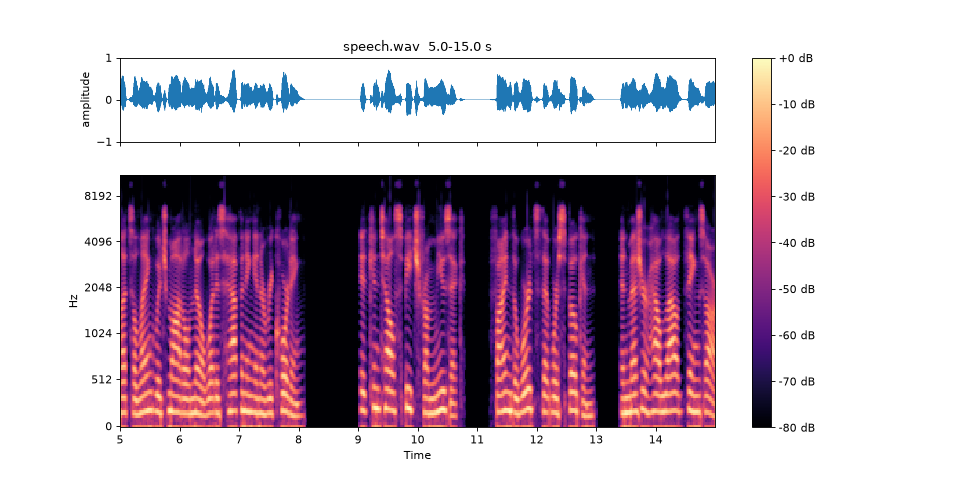

# earmcp

An MCP server that gives AI coding agents **"ears"** to understand local audio files — running **100% locally** with zero cloud API calls.



## Tools

| Tool | What it does | Backend |
|---|---|---|
| `classify_sounds` | Multi-label sound event tagging across **527 AudioSet classes** (speech, music, instruments, alarms, vehicles, animals) with 10-second sliding-window timelines | `MIT/ast-finetuned-audioset-10-10-0.4593` (PyTorch / Transformers) |
| `transcribe` | Automatic speech-to-text across ~100 languages with auto-detection and timestamped segments (handles audio >30 s) | `openai/whisper-base` (Transformers pipeline) |
| `analyze_audio` | DSP signal metrics: duration, sample rate, channels, peak/RMS dBFS, clipping %, silence %, active sound segments, dominant frequency/note, spectral centroid, pitch (`pyin`), tempo (BPM), and Krumhansl-Schmuckler musical key | `librosa` + `numpy` |
| `spectrogram` | Renders a combined **waveform + Mel spectrogram (dB)** PNG returned directly as an MCP image for vision-capable models | `librosa` + `matplotlib` |

All four tools accept `start` and `duration` (seconds) to inspect slices of long recordings, and heavy PyTorch/Transformers imports stay lazy so server startup stays fast.

## Quickstart

```bash
python -m venv .venv
.venv/Scripts/pip install -r requirements.txt   # Linux/macOS: .venv/bin/pip install -r requirements.txt
```

### Register with Claude Code (or any stdio MCP client)

```bash
claude mcp add earmcp --scope user -- /absolute/path/to/.venv/Scripts/python.exe /absolute/path/to/server.py
```

### Swap Hugging Face models (optional)

```bash
export EARMCP_WHISPER="openai/whisper-small"
export EARMCP_CLASSIFIER="MIT/ast-finetuned-audioset-10-10-0.4593"
```

## Verify

Run the end-to-end stdio MCP self-test (downloads model weights once on first run, ~500 MB):

```bash
.venv/Scripts/python selftest.py
```

Checks tool discovery, `analyze_audio` (440 Hz tone + 120 BPM arpeggio), `classify_sounds`, `transcribe` (>30 s speech), and `spectrogram` PNG output.

## Supported Formats

`wav`, `flac`, `ogg`, and `mp3` work out of the box via `librosa`/`soundfile`. `m4a`, `aac`, and video containers work when `ffmpeg` is on `PATH`.

## License

MIT
